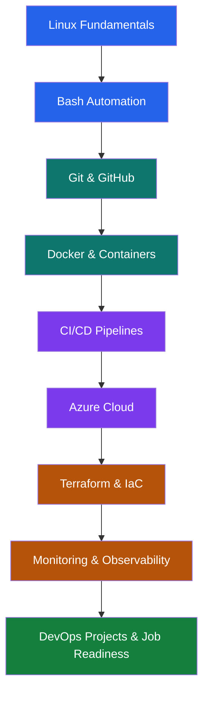

 

# 👋 Hey, I'm Chandu Telagamsetti

### Aspiring DevOps Engineer | Linux & Bash Automation | Cloud Enthusiast

Building automation scripts, exploring cloud infrastructure, and learning how to make software delivery more reliable and efficient.

---

## 🚀 About Me

- 🎓 Student building practical skills in **DevOps, Linux, and Cloud Computing**.
- 🐧 Working with **Linux and Ubuntu virtual machines**.
- ⚙️ Developing **Bash scripts** to automate repetitive tasks.
- ☁️ Exploring **Microsoft Azure** and cloud infrastructure fundamentals.
- 🔧 Learning Git, GitHub, scripting, and software delivery workflows.
- 🎯 **2027 Goal:** Secure my first DevOps or Cloud Engineer role through hands-on projects and continuous learning.

## 🛠️ Tech Stack & Tools

### 🐧 Operating Systems & Scripting

### ☁️ Cloud & Infrastructure

### 🔧 Version Control & Development Tools

### 📚 Currently Learning

*Docker, CI/CD, and Terraform are learning goals—not claims of production experience.*

---

## 🔥 Featured DevOps Projects

### 🐚 Bash Automation Scripts

A collection of shell scripts designed to automate common Linux tasks and build practical scripting skills.

**Focus areas:**
- Bash scripting and command-line fundamentals
- File and directory operations
- Automation of repetitive tasks
- Script execution, permissions, and error handling

🔗 **[Explore My DevOps Projects](https://github.com/ChanduTelaga/devops-projects)**

### 🎯 What's Next?

- 🐳 Containerizing applications with Docker
- 🔄 Building CI/CD pipelines with GitHub Actions
- ☁️ Practicing cloud infrastructure on Azure
- 🏗️ Exploring Infrastructure as Code with Terraform
- 📊 Learning monitoring, logging, and troubleshooting

---

## 🗺️ My DevOps Learning Roadmap

**Current focus:** Linux, Bash automation, and Git workflows.

**Long-term goal:** Build, automate, deploy, and monitor reliable applications and cloud infrastructure.

---

## 📈 GitHub Activity

---

## 🌱 Beyond the Terminal

- 🐧 Enjoy exploring Linux and learning how systems work.
- 🧩 Like solving technical problems and automating repetitive tasks.
- 🎮 Anime, coding challenges, and lo-fi music keep me going.
- 💡 **My philosophy:** Learn by building, automate what you can, and improve with every iteration.

---

## 🤝 Let's Connect

- 💼 [LinkedIn](https://www.linkedin.com/in/chandutelagamsetti/)
- 🐙 [GitHub](https://github.com/ChanduTelaga)
- 📂 [DevOps Projects Repository](https://github.com/ChanduTelaga/devops-projects)
- 📧 [Email Me](mailto:202217b3191@wilp.bits-pilani.ac.in)

⭐ Thanks for visiting my profile!

*Always learning. Always building. Automating one task at a time.*

